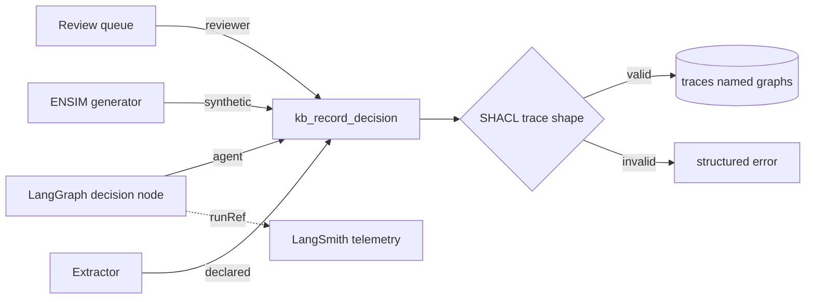

# Design Document: Decision Traces

- Requirements: [requirements.md](requirements.md)
- Narrative: [kb-prototype-architecture.md, "Context graph: decision traces"](../../../docs/architecture/kb-prototype-architecture.md#context-graph-decision-traces)
- Status: Draft

## Overview

Traces are stored in the KB's Oxigraph store in `kb:graph/traces/<origin>/<yyyy-mm>` named graphs,
typed by the KB ontology and validated by a SHACL shape. They enter through one write path:
`kb_record_decision` (spec `kb-mcp-contract`).



## Data model

```json
{
  "origin": "agent|reviewer|synthetic|declared",
  "decisionPoint": "kb:process/.../milestone-b",
  "decidedBy": "agent:LoadMasterV1.Instance2",
  "inRole": "kb:role/...",
  "underAuthority": {"issuance": "kb:issuance/dodi-5000-85", "version": "kb:graph/src/L1/..."},
  "used": ["claim:...", "entity:..."],
  "optionsConsidered": ["...", "..."],
  "exception": {"kind": "waiver", "approvedBy": "...", "unknown": false},
  "outcome": {"summary": "...", "changed": ["entity:..."]},
  "precedent": ["trace:..."],
  "atTime": "2026-10-17T12:00:00Z",
  "runRef": "langsmith:<run id>",
  "unknown_fields": ["optionsConsidered"]
}
```

`unknown_fields` implements R1.3 and R5.1.

## LangGraph capture pattern (Aircrew-LangChain)

A decision node is the node that commits an action with consequences outside the graph's state.
Its order of operations:

1. Assemble the trace from state: role, authority checks already made by the governed envelope, facts
   consulted (claim IDs from KB tool results), options.
2. Call `kb_record_decision`. On failure, stop and surface the error (R3.3).
3. Store the trace ID in state, then commit the action.

The governed envelope already owns authority checks and phase gates, so `underAuthority` and
`inRole` come from the envelope, not from the model's text.

## Error handling

Invalid traces are rejected with the failing shape path. Synthetic traces are excluded from
precedent results unless `include_synthetic=true` (R4.2).

## Testing strategy

- Shape fixtures for each origin, including declared traces with unknown reasoning.
- An Aircrew-LangChain integration test: a recorded mission run produces one trace per decision node,
  each linked to its run.
- CQ10 golden answer over a fixture of mixed-origin traces.
