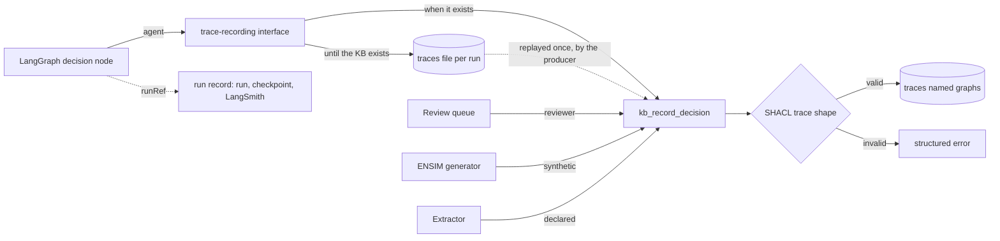

# Design Document: Decision Traces

- Requirements: [requirements.md](requirements.md) (approved 2026-11-06)
- Narrative: [kb-prototype-architecture.md, "Context graph: decision traces"](../../../docs/architecture/kb-prototype-architecture.md#context-graph-decision-traces)
- Status: Draft. Revision proposed 2026-11-06, awaiting approval: one recording interface with a
  file backend until the KB trace store exists (R3), the JSON Schema (R1.4), and import at D3 (R7).

## Overview

Traces end up in the KB's Oxigraph store in `kb:graph/traces/<origin>/<yyyy-mm>` named graphs,
typed by the KB ontology and validated by a SHACL shape. They enter the store through one write
path: `kb_record_decision` (spec `kb-mcp-contract`).

The KB trace store does not exist before D3 (KB Phases 0 to 4, from May 2027), while agent decisions
are recorded from D1. Producers therefore record through a **trace-recording interface** with two
backends. Until the KB exists the file backend writes each trace to a file with the producer's run
records. When `kb_record_decision` exists the KB backend calls it, and the producer replays its
files through it once. Decision nodes call the interface, never a backend, so they do not change at
D3 (R3.5).



The replay is driven by the producing repo through `kb_record_decision`, so the KB never reads
another repo's files and the dependency arrows in `portfolio.md` are unchanged.

## Data model

One trace, as written to a file or passed to `kb_record_decision`:

```json
{
  "id": "trace:aircrew-langchain/live3/0007",
  "origin": "agent",
  "decisionPoint": "aircrew:decision/authorize_airdrop",
  "decidedBy": "agent:GeneralistV1.Instance1",
  "inRole": "ensim@aa7b714:role/aircraft-commander",
  "underAuthority": {"issuance": "aircrew:grant/authorize_airdrop", "version": "aircrew@94b8c71"},
  "used": ["state:nav.carp", "state:atc.clearances/ROMEO4_TRANSIT"],
  "optionsConsidered": [],
  "exception": null,
  "outcome": {"summary": "Drop authorized at T+64", "changed": ["state:authority.drop_authorized"]},
  "precedent": [],
  "atTime": "2026-12-01T15:04:05Z",
  "runRef": {"run": "live3", "checkpoint": "1f1d9fd7-0a31-6cc4-80cf-5923c2f9a0b1", "langsmith": null},
  "unknown_fields": ["optionsConsidered"],
  "pending": ["inRole", "underAuthority.issuance", "underAuthority.version"]
}
```

- `id` is the trace ID returned by the interface and stored in the producer's state (R3.1):
  `trace:<producer>/<run>/<n>`, with `n` counting traces within the run.
- `unknown_fields` implements R1.3 and R5.1: the value was not known and is left empty.
- `pending` implements R3.6: the value is known but is a local identifier (prefix `ensim@<commit>:`
  or `<producer>:`) because the KB identifier does not exist yet. It is resolved at import (R7.1).
  A field is never in both lists.
- `runRef` is an object (R3.2). `langsmith` is null when tracing is off, which is the default in
  Aircrew-LangChain.
- `used` may name recorded state (`state:` paths) as well as KB claims and entities, since a
  simulated decision draws on the simulation's own instruments.

### JSON Schema (R1.4)

This schema is the contract until the SHACL shape of R1.2 exists. Producers pin it by umbrella
commit. When the KB adds the SHACL shape, a KB test checks that every trace valid under this schema
and with no `pending` fields is valid under the shape.

```json
{
  "$schema": "https://json-schema.org/draft/2020-12/schema",
  "$id": "https://github.com/semanticarchitectures/acquisition-knowledge-system/.kiro/specs/decision-traces/trace.schema.json",
  "title": "Decision trace",
  "type": "object",
  "required": ["id", "origin", "decisionPoint", "decidedBy", "inRole", "underAuthority", "used",
               "optionsConsidered", "exception", "outcome", "precedent", "atTime", "runRef",
               "unknown_fields", "pending"],
  "additionalProperties": false,
  "properties": {
    "id": {"type": "string", "pattern": "^trace:[a-z0-9-]+/[^/]+/[0-9]+$"},
    "origin": {"enum": ["agent", "reviewer", "synthetic", "declared"]},
    "decisionPoint": {"type": "string", "minLength": 1},
    "decidedBy": {"type": "string", "pattern": "^(agent:[A-Z][A-Za-z0-9]*V[0-9]+\\.Instance[0-9]+|[a-z]+:.+)$"},
    "inRole": {"type": ["string", "null"]},
    "underAuthority": {
      "type": ["object", "null"],
      "required": ["issuance", "version"],
      "additionalProperties": false,
      "properties": {"issuance": {"type": ["string", "null"]}, "version": {"type": ["string", "null"]}}
    },
    "used": {"type": "array", "items": {"type": "string"}},
    "optionsConsidered": {"type": "array", "items": {"type": "string"}},
    "exception": {
      "type": ["object", "null"],
      "required": ["kind", "approvedBy", "unknown"],
      "additionalProperties": false,
      "properties": {"kind": {"type": ["string", "null"]}, "approvedBy": {"type": ["string", "null"]},
                     "unknown": {"type": "boolean"}}
    },
    "outcome": {
      "type": ["object", "null"],
      "required": ["summary", "changed"],
      "additionalProperties": false,
      "properties": {"summary": {"type": ["string", "null"]},
                     "changed": {"type": "array", "items": {"type": "string"}}}
    },
    "precedent": {"type": "array", "items": {"type": "string", "pattern": "^trace:"}},
    "atTime": {"type": "string", "format": "date-time"},
    "runRef": {
      "type": ["object", "null"],
      "required": ["run", "checkpoint", "langsmith"],
      "additionalProperties": false,
      "properties": {"run": {"type": "string"}, "checkpoint": {"type": ["string", "null"]},
                     "langsmith": {"type": ["string", "null"]}}
    },
    "unknown_fields": {"type": "array", "items": {"type": "string"}, "uniqueItems": true},
    "pending": {"type": "array", "items": {"type": "string"}, "uniqueItems": true}
  }
}
```

## Trace-recording interface

```
record_decision(trace) -> trace_id      raises TraceRecordingError
```

- It validates the trace against the JSON Schema, assigns `id`, writes it through the active
  backend, and returns the ID only once the write is durable.
- **File backend** (until the KB exists): appends one JSON line to `traces_<run>.jsonl` with the
  producer's run records, flushes and syncs it, then returns. One file per run.
- **KB backend** (from D3): calls `kb_record_decision` and returns the KB's trace ID.
- The backend is a configuration of the producer, not a choice made in decision nodes.

## LangGraph capture pattern (Aircrew-LangChain)

A decision node is the node that commits an action with consequences outside the graph's state.
Its order of operations:

1. Assemble the trace from state: the acting agent's id and role, the authority checks already made
   by the governed envelope, the state and facts consulted, options.
2. Call `record_decision`. On failure, stop and surface the error, and do not commit (R3.3).
3. Store the trace ID in state, then commit the action.

The governed envelope already owns authority checks and phase gates, so `decidedBy`, `inRole` and
`underAuthority` come from the envelope and the mission order, not from the model's text. Before D3,
`inRole` is the ENSIM role ID from the order and `underAuthority` names the envelope's grant; both
are listed in `pending`.

## Import at D3 (R7)

The producer replays each traces file through `kb_record_decision`, in order. For each trace the KB
resolves every `pending` field to a KB identifier, validates against the SHACL shape, and stores it.

- A trace whose ID does not appear in the producing run's final committed state (the turn failed
  after recording) is imported marked uncommitted, not dropped: it is a decision that was made and
  not carried out.
- Replay is idempotent by trace ID, so a failed import can be rerun.

## Error handling

- Invalid traces are rejected with the failing path: the schema path before D3, the shape path
  after (R7.2).
- A pending identifier the KB cannot resolve rejects that trace with the field named; the file is
  not changed (R7.2).
- A failed file write or KB call raises `TraceRecordingError`; the decision node does not commit
  (R3.3).
- Synthetic traces are excluded from precedent results unless `include_synthetic=true` (R4.2).

## Testing strategy

- Schema fixtures for each origin, including declared traces with unknown reasoning and agent traces
  with pending fields; invalid fixtures for each required field.
- An Aircrew-LangChain integration test: a recorded scripted mission produces one trace per decision
  node, each valid under the schema, each ID present in the final state, each linked to its run and
  checkpoint.
- A failure test: when the file backend cannot write, the decision node commits nothing and the
  failure appears in the run's events.
- At D3: a replay test from a recorded traces file, including an uncommitted trace and an
  unresolvable pending identifier; and the schema-to-shape agreement test.
- CQ10 golden answer over a fixture of mixed-origin traces.
