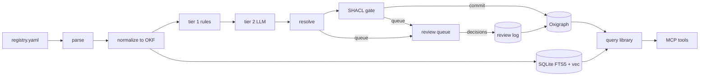

# Design Document: Knowledge Base Prototype

- Requirements: [requirements.md](requirements.md)
- Narrative and rationale: [docs/architecture/kb-prototype-architecture.md](../../../docs/architecture/kb-prototype-architecture.md)
  (this design does not restate it)
- Status: Draft

## Overview

A Python package (`pokb`, working name) with idempotent pipeline stages, an embedded RDF store and
passage index, and a query library that implements the KB MCP contract (spec `kb-mcp-contract`).
See the narrative for the full architecture diagram, ontology rationale and stack choices.

## Architecture



Each stage reads and writes files keyed by content hash, so a re-run touches only what changed
(R6.3).

## Components and interfaces

| Component | Input | Output | Requirements |
| --- | --- | --- | --- |
| `ingest.register` | `sources/registry.yaml` | Validated `SourceVersion` records | R1 |
| `ingest.parse` | Raw file | Structured text with page numbers (isolated process) | R2.1, R2.2 |
| `ingest.normalize` | Structured text | OKF Markdown with stable anchors, per layer | R2.1, R2.3, R2.4 |
| `extract.rules` | OKF section | Tier 1 entity hits | R3.1 |
| `extract.llm` | OKF section, ontology slice, JSON schema | `CandidateClaim[]` | R3.2–R3.5 |
| `resolve` | Candidates, canonical registry | Resolved candidates or `ReviewItem` | R4 |
| `validate.gate` | Resolved candidates, shapes | Committed claims or `ReviewItem` | R5 |
| `store.graph` | Committed claims | Named graphs in Oxigraph | R5.3, R6, R7.1 |
| `store.index` | OKF sections | FTS5 + vector index | R2 |
| `cq` | CQ ID, parameters, scope | Rows with claim IDs, or a gap | R8 |
| `export` | Graph + index | Snapshot; Foundry datasets | R10 |

## Data models

### Source registry entry (YAML)

```yaml
- id: dodi-5000-85
  url: https://...                    # as published
  issuer: OUSD(A&S)
  title: Major Capability Acquisition
  layer: L1
  published: 2026-xx-xx
  retrieved: 2026-xx-xx
  sha256: ...
  release_basis: public               # anything else is refused (R1.3)
  license: public-domain-us-gov
  supersedes: [dodi-5000-85-2020]
```

Field values above are placeholders, not facts.

### Candidate claim

```json
{
  "subject": "kb:org/...", "predicate": "kb:reportsTo", "object": "kb:org/...",
  "nary": {"validFrom": "2026-01-01", "validTo": null},
  "source_version": "dodi-5000-85@sha256:...",
  "anchor": "okf://L1/dodi-5000-85#sec-3-2",
  "span": [1204, 1311],
  "confidence": 0.93,
  "shape": "kb:ReportingRelationShape",
  "model": "<pinned id>", "prompt_hash": "..."
}
```

### Named graph IRIs

| Graph | IRI pattern |
| --- | --- |
| Ontology | `kb:graph/ontology/<version>` |
| Source version | `kb:graph/src/<layer>/<source-id>/<sha256-prefix>` |
| Review decisions | `kb:graph/review/<yyyy-mm>` |
| Decision traces | `kb:graph/traces/<origin>/<yyyy-mm>` (origin: agent, reviewer, synthetic, declared) |
| Provenance | `kb:graph/prov` |

Echelon scope is a property of each source-version graph in `kb:graph/prov`, which is how R7 is
enforced at query time.

## Error handling

| Condition | Behavior |
| --- | --- |
| Unregistered or non-public source | Refuse; log with path and reason (R1.2, R1.3) |
| Parse failure | Mark the source version failed; keep the previous version live |
| Model call failure or schema-invalid output | Retry with backoff up to a fixed count, then queue the section for re-extraction; never commit partial output |
| SHACL violation | Reject the candidate; log shape and focus node (R5.1) |
| Ambiguous entity match | Queue for review; never auto-merge (R4.2) |
| Superseded source | Mark graph superseded; flag unsupported facts (R6.2) |
| Query outside scope | Omit silently (R7.3) |
| CQ with no answer | Return a gap object, logged to the gap backlog (R8.4) |

## Testing strategy

- **Shape tests:** every SHACL shape has passing and failing fixtures.
- **CQ golden-answer tests:** one per CQ, against a fixture graph, in CI (R8.2).
- **Extraction regression:** the gold set scored on every change to prompts, models or shapes (R11.1).
- **Rebuild test:** delete the store, rebuild from OKF + registry + review log, compare (R10.3).
- **Scope tests:** a client scoped to L2 never sees L3 or L4 facts (R7.2, R7.3).
- **Graph vs vector comparison:** run at Phase 4 per R11.3.
