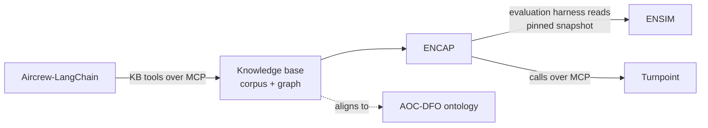

# Portfolio: components and dependency rules

AKS is an umbrella. Code lives in component repos. This repo holds specs, architecture and
decisions that span them.

## Components

| Component | Repo | Role in AKS | Stack | Boundary |
| --- | --- | --- | --- | --- |
| **ENCAP** (Enterprise Agent Platform) | TBD | The runtime: synthesis to OKF, document index, operating model, agents, personnel console | TypeScript monorepo (`@encap/*`) | Owns runtime and governance |
| **Knowledge base (pokb, working name)** | TBD | The corpus and knowledge graph: registered public sources, OKF bundles per echelon, ontology-guided extraction, RDF graph, context graph | Python 3.12, Oxigraph, pySHACL | Data and build pipeline; consumed one-directionally |
| **ENSIM** | [semanticarchitectures/ENSIM](https://github.com/semanticarchitectures/ENSIM) | The test enterprise: org-doctrine model, doctrine processes, missions, role-emulating T&E agents | npm/TypeScript + Java | Read as a pinned snapshot, for evaluation only |
| **Turnpoint** | [semanticarchitectures/turnpoint](https://github.com/semanticarchitectures/turnpoint) | Domain tool agents call over MCP; the pattern for agents-first tool design. Mid horizon: planning for unmanned aircraft. Far horizon: the software between unmanned mission plans and the AOC (goal revision pending, see vision open questions) | Python | Called, never embedded |
| **Aircrew-LangChain** (Airdrop Alpha, LangGraph) | [semanticarchitectures/Aircrew-LangChain](https://github.com/semanticarchitectures/Aircrew-LangChain) | First LangGraph host for decision-trace capture | Python, LangGraph | Consumer of KB tools |
| **AOC-DFO** | TBD | BFO/CCO ontology of AOC data flows; the alignment target for the KB ontology. Far horizon: models the AOC side of the unmanned-to-AOC interface | OWL | Reference ontology; imported, not modified |

Repos marked TBD: add the URL here when it exists. Do not guess.

## Dependency direction

Arrows point from consumer to dependency. Nothing flows back into the corpus, Turnpoint or ENSIM,
so each stays releasable on its own.

## Rules for agents working in this repo

- A spec here declares its **owning repo(s)** at the top of `requirements.md`. Each task names the
  repo it lands in.
- Never copy component code or data into this repo. Link to it, pinned to a commit or tag.
- A change that would add a dependency against the arrows above needs an ADR first.
- When a spec becomes internal to one component, move it to that repo's `.kiro/specs/` and leave a
  one-line pointer in `docs/specs-index.md`.
