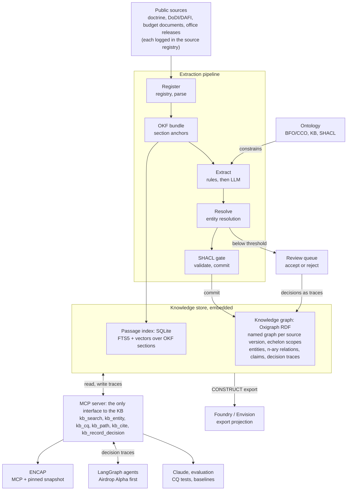

# Organizational Knowledge Base Prototype — Architecture & Implementation

> Source: Claude doc of the same title, 2026-10-17, Kevin Kelly. Imported as written; the two
> diagrams are redrawn in Mermaid. This is the design narrative behind spec
> `.kiro/specs/knowledge-base-prototype`. Points where it departs from the reference architecture
> are recorded in ADRs 0002–0004.

## Purpose, scope and assumptions

The prototype must show that a public corpus can become an ontology-conformant, fully cited knowledge
graph of the Mission Planning program office, which agents query and write decisions back to through
MCP. It is a build-to-learn increment that sets up the CUI pilot. It is not a product.

**Assumptions carried from earlier decisions**

- Public data only, down to program-office level. Project-level scope waits for the CUI pilot.
- The prototype focuses on the Mission Planning program office under PAE C3BM.
- It is a separate repo, consumed one-directionally by ENCAP as its first real corpus.
- AI agents are the primary consumer. Every answer carries a per-claim citation.
- The core is platform-agnostic. Foundry/Envision is an adapter, not the home.
- Knowledge graphs are scoped by echelon: government, DoD, Air Force, program office. *(The reference
  architecture defines five layers, L0–L4, adding Portfolio; the spec adopts L0–L4.)*

**What the prototype must prove**

1. The agreed competency questions can be answered from the graph, each answer traceable to a source
   passage.
2. Ontology-guided extraction yields committed claims precise enough to trust without line-by-line
   review.
3. The graph updates incrementally when a source changes or is superseded.
4. The decision-trace schema can capture a decision at the moment it is made, demonstrated on
   synthetic decisions.
5. The graph adds measurable value over vector-only retrieval on multi-hop questions.

**Out of scope:** CUI, a production UI, full OWL reasoning beyond what the competency questions need,
and Foundry as the system of record.

## Competency questions

Ten competency questions (CQs) drive every design choice below. Each becomes a parameterized query
and an automated golden-answer test. The ontology models only what these questions need. This is a
draft list to confirm before Phase 0 closes.

| ID | Question | Facet | Hops |
| --- | --- | --- | --- |
| CQ1 | What is the Mission Planning program office's reporting chain up to the Service Acquisition Executive? | Structure | 3–5 |
| CQ2 | What capabilities does the office deliver, and which operational commands use them? | Mission | 2–3 |
| CQ3 | Which DoD and DAF issuances govern the office's acquisition pathway decisions? | Authority | 2 |
| CQ4 | Which products are in the portfolio, and which acquisition pathway is each on? | Resources | 2 |
| CQ5 | Which external organizations does the office depend on (test, sustainment, training), and through what relationship? | Relationships | 2–3 |
| CQ6 | Which program elements fund the portfolio, and what changed between budget submissions? | Resources, time | 2–3 |
| CQ7 | What did the office's organizational structure look like on a given date? | Time | 3–5 |
| CQ8 | If a source is superseded, which facts lose all support? | Provenance | 2 |
| CQ9 | What decision moves a product to its next milestone, and who is the decision authority? | Operations | 3–4 |
| CQ10 | For a given decision, what inputs, policy version and precedents applied? | Context graph | 3+ |

CQ1, CQ5, CQ7 and CQ9 are the multi-hop questions a vector-only system answers poorly. They are the
core of the value test in Evaluation.

## Architecture overview

The architecture has five layers: a registered public corpus, an extraction pipeline constrained by
the ontology, an embedded knowledge store, one MCP interface, and the consumers. The knowledge graph
is the authoritative copy. Foundry gets a projection of it.



Read it top to bottom for how a claim gets in, and bottom to top for how an answer is cited. Decision
traces enter from two places: reviewers in the queue and agents at their decision nodes.

## Ontology layer

The ontology is fixed before extraction starts, and extraction is constrained to it. It has three
tiers, and only the middle tier is new work.

1. **Upper: BFO and CCO, imported unchanged.** This keeps the KB aligned with AOC-DFO, so the two can
   be joined later without remapping.
2. **Mid-level: a small KB ontology, subclassed from CCO.** It holds about 20 classes and 30
   properties, limited to what the CQs need:
   - *Organization* (program office, PAE, directorate, command, external agency), *Role*,
     *Office Symbol*
   - *Mission* and *Capability*, linked to organizations by *delivers* and *uses*
   - *Authority*: an issuance (DoDI, DAFI, DAFMAN, law) and its *version*, linked by *governs* and
     *supersedes*
   - *Resource*: product, program element, funding line
   - *Agreement* and *Relationship* as n-ary nodes (supports, tests, sustains, trains), so each
     carries its own dates and source
   - *Process*, *Milestone*, *Decision Point* and *Decision Authority*
3. **Shapes: SHACL**, one shape per class and n-ary relation. They serve three purposes: they gate
   extraction, they validate commits, and they generate the JSON schema the LLM extractor must fill.

**Time.** Relationships that change (assignment, reporting line, portfolio membership, funding) are
n-ary nodes with `validFrom` and `validTo`. That is what makes CQ7 answerable and keeps the graph
from stating stale structure as current.

**Provenance.** Each source version loads into its own named graph, described with PROV-O: issuing
organization, publication date, retrieval date, content hash, license and supersession. Each claim
points to the OKF section anchor it came from. A fact is supported while at least one non-superseded
source asserts it, which is how CQ8 works.

**Echelon scoping.** Echelons are named-graph sets (government, DoD, Air Force, program office), not
separate databases. A scoped agent queries only its sets, and the full graph stays joinable.

**Tooling.** Protégé for authoring, ROBOT for builds and QC reports, all under version control.
Ontology changes go through review like code.

## Ingestion and extraction pipeline

The pipeline is plain Python stages with a CLI. Each stage is idempotent and keyed by content hash,
so re-running only touches what changed. It does not use LangChain or LangGraph; orchestration
frameworks belong in the agent layer.

1. **Register.** Each source gets a registry entry (YAML): URL, issuing org, publication date,
   retrieval date, hash, license and `supersedes`. A file with no registry entry is never ingested.
2. **Parse.** Use ENCAP's PDF extraction service if it is ready; otherwise use Docling behind the
   same process boundary. Output keeps headings, tables and page numbers.
3. **Normalize to OKF Markdown** with stable section anchors. The section is the citation unit for
   both ENCAP and the graph.
4. **Tier 1, rules and gazetteer.** High-precision patterns for office symbols, issuance numbers
   (DoDI 5000.85, DAFI 63-101), program element numbers, dates and known organization names. These
   seed entities and anchor the LLM tier.
5. **Tier 2, ontology-guided LLM extraction.** For each section:
   - Retrieve the relevant ontology slice (classes plus the SHACL shapes near the Tier 1 hits) and
     the candidate canonical entities.
   - Prompt for structured output whose JSON schema is generated from those shapes.
   - Each claim returns a source span, a confidence and the shape it fills. Free-text relations are
     rejected.
6. **Entity resolution.** Resolve against a canonical registry of organizations, aliases, office
   symbols and renames:
   - Deterministic first: office symbol, exact alias, or a known rename.
   - Then embedding candidates with model adjudication.
   - Nothing below threshold is auto-merged. It goes to the review queue, because a silent merge of
     two organizations is the costliest error this system can make.
7. **SHACL gate.** pySHACL validates each candidate. Violations are rejected, low confidence goes to
   review, and the rest commits.
8. **Commit** to the source version's named graph, with each claim linked to its OKF anchor.
9. **Supersession and update.** A changed source regenerates only its own named graph. A superseding
   source marks the old graph superseded. Facts left with no support are flagged, not deleted.

**Review queue.** A small artifact page lists ER candidates and low-confidence claims with their
source passage, and records accept or reject decisions. Reviewer decisions are themselves decision
traces, which gives the context graph real (not synthetic) data from day one.

**Models.** A capable model for bulk extraction and a stronger one for adjudication, both pinned by
version and prompt hash, so a re-run is reproducible.

## Storage and query layer

Recommendation: an embedded RDF store (Oxigraph) for the graph, plus SQLite (FTS5 and vectors) for
passage retrieval. Both are files in the repo's data directory, with no servers. This keeps ENCAP's
embedded-first stance and still gives native named graphs, SPARQL and SHACL.

| Store | Holds | Why |
| --- | --- | --- |
| Oxigraph (pyoxigraph) | Ontology, entities, claims, decision traces, as named graphs | Named graphs carry provenance, supersession and echelon scope directly. SPARQL property paths answer the multi-hop CQs. It conforms to BFO/CCO with no translation. |
| SQLite FTS5 + sqlite-vec | OKF section chunks and embeddings | Hybrid passage search for citation and for questions the graph does not model. The same shape as ENCAP's index. |

**Why not a property graph (Neo4j) now.** It has the better GraphRAG tooling, but it would break
BFO/CCO alignment and push provenance into edge properties. It would also add a server. Revisit only
if traversal volume or graph-algorithm needs outgrow SPARQL.

**Query patterns.**

- **CQ templates.** One parameterized SPARQL query per CQ, versioned and unit-tested. This is the
  default path for agents, because text-to-SPARQL is the least reliable link in GraphRAG.
- **Entity neighborhood.** Expand one to two hops around resolved entities, as of a date, within the
  caller's echelon scope.
- **Hybrid.** Find passages by search, map their anchors to claims, then expand through the graph.
  This is the route for open-ended questions.
- **Free-form SPARQL.** Read-only, time-limited, offered to expert users and evaluation scripts, not
  to every agent.

## Context graph: decision traces

Decision traces live in the same store, in their own named graphs, typed by the same ontology. A
trace is a first-class record tied to entities, not a log line.

**Trace schema (a PROV-O activity with KB properties):**

| Field | Meaning |
| --- | --- |
| `decisionPoint` | Which process step or milestone this decides |
| `decidedBy` / `inRole` | The person or agent, and the role it acted in |
| `underAuthority` | The issuance and the exact version applied |
| `used` | The claims and entities consulted, by ID |
| `optionsConsidered` | The alternatives, briefly |
| `exception` | A deviation, waiver or override, and who approved it |
| `outcome` | What was decided, with any entities it changed |
| `precedent` | Earlier traces cited as similar |
| `atTime` / `runRef` | When it happened, and a link to the agent run or source record |

**Three capture paths for the prototype:**

1. **Agent decisions.** A LangGraph node at each real decision point calls the `record_decision` MCP
   tool before it commits its action. Airdrop Alpha is the first host. LangSmith traces stay as
   telemetry, linked by `runRef`.
2. **Reviewer decisions.** Accept and reject choices in the review queue are recorded as traces.
   These are small but real.
3. **Synthetic institutional decisions.** ENSIM's role-emulating agents generate milestone and
   funding decisions against the real authorities in the graph. This tests the schema before the CUI
   pilot brings real ones.

Decisions reported in public sources (milestone announcements, contract awards) are extracted as
declared decisions. They carry outcome and authority but no reasoning, and the prototype marks them
that way rather than inventing the missing fields.

## Agent and access layer

One MCP server is the only interface to the KB. ENCAP, LangGraph agents, Claude and evaluation
scripts all go through it, so access control, echelon scoping and citation behave the same for every
consumer. *(See ADR 0004 for how this squares with "ENCAP is the only runtime".)*

| Tool | Does | Returns |
| --- | --- | --- |
| `kb_search` | Hybrid passage search within a scope | Passages with OKF anchors |
| `kb_entity` | Resolves a name or ID and expands its neighborhood, optionally as of a date | Entity, typed links, sources |
| `kb_cq` | Runs a CQ template with parameters | Result rows, each with claim IDs |
| `kb_path` | Finds relationship paths between two entities | Paths, each edge cited |
| `kb_cite` | Expands a claim to its provenance chain | Source, version, anchor, supersession status |
| `kb_record_decision` | Writes a decision trace (write scope only) | Trace ID |
| `kb_sparql` | Read-only, time-limited SPARQL (expert scope) | Bindings |

**Scopes.** Each MCP client gets a token mapped to a set of echelon named graphs and read or write
permission. This is the prototype of the role-based access ENCAP needs, and the same mechanism
carries a CUI boundary later.

**Consumers.**

- **ENCAP** reads through MCP for live queries, and pins a snapshot export (N-Quads plus the SQLite
  index) for reproducible evaluation. That matches how it already reads ENSIM.
- **LangGraph agents** (Airdrop Alpha first) use the read tools for grounding and
  `kb_record_decision` at decision nodes.
- **Turnpoint and other MCP tools** sit alongside the KB, not inside it, following the umbrella
  reference architecture.

**Foundry/Envision adapter.** An export job turns the graph into tabular datasets with SPARQL
CONSTRUCT, one dataset per class and per link type, with source and claim IDs as columns. Those map
to Foundry object and link types. Foundry is a projection of the graph, never the authoritative copy.

## Technology stack and repo layout

The stack is Python 3.12, because the semantic tooling (pyoxigraph, pySHACL, rdflib, Docling) is
Python-first. ENCAP stays TypeScript and talks to the KB only through MCP and snapshot files, so the
language difference costs nothing.

| Concern | Choice |
| --- | --- |
| Packaging | uv, one package, CLI entry point `pokb` |
| Ontology authoring and QC | Protégé, ROBOT |
| Graph store | pyoxigraph (embedded) |
| Validation | pySHACL; rdflib for SHACL-to-JSON-schema generation |
| Parsing | ENCAP extraction service, or Docling as fallback |
| Passage index | SQLite FTS5 + sqlite-vec |
| Extraction schemas | Pydantic models generated from SHACL shapes |
| LLM access | Provider SDK behind a thin interface, so the IL5 model choice is a config change |
| MCP server | MCP Python SDK (FastMCP) |
| Agent orchestration | LangGraph, in consumer repos only |
| Tests | pytest: shape tests, CQ golden-answer tests, extraction regression set |
| License | Apache 2.0 with NOTICE, matching ENSIM |

```
pokb/
  AGENTS.md            # family conventions: cite, classification boundary, provenance, flag gaps
  ontology/
    imports/           # BFO, CCO (pinned)
    pokb.ttl           # mid-level ontology
    shapes/            # SHACL, one file per class family
  sources/
    registry.yaml      # every source: url, issuer, dates, hash, license, supersedes
    raw/  okf/         # fetched originals, normalized OKF bundle
  src/pokb/
    ingest/  extract/  resolve/  validate/  store/
    cq/                # one .rq template + test per CQ
    mcp/               # server and tool definitions
    export/            # snapshot, Foundry datasets
  review/              # review-queue artifact + decisions log
  eval/                # gold annotations, baselines, reports
  docs/PLAN.md
```

## Implementation plan

The proposed plan is about 12 weeks in five increments. Each one ends in a working, demonstrable
system, and each gate is a CQ result, not a document. Durations are a first estimate for one engineer
plus part-time ontology and domain review. They are not a commitment.

| Phase | Proposed weeks | Delivers | Gate |
| --- | --- | --- | --- |
| 0 Foundations | 1–2 | Source inventory, CQs confirmed, ontology v0, repo and failing CQ tests | CQs backed by real sources |
| 1 Thin slice | 3–4 | 10 sources in, structure facts end to end, SHACL + Oxigraph, MCP read tools | CQ1, CQ2 answered with citations |
| 2 Breadth | 5–7 | All relations, ER + review queue, time and supersession, gold-set scoring | 8 of 10 CQs; precision ≥ 0.90 |
| 3 Context graph | 8–9 | Trace schema, `record_decision`, Airdrop Alpha hook, ENSIM synthetic decisions | CQ9, CQ10 pass on synthetic data |
| 4 Integration | 10–12 | ENCAP consumes, Foundry export, graph vs vector evaluation, CUI pilot memo | Demo + report; CUI go/no-go |

Phase 1 deliberately covers organizational structure only, end to end, before any breadth. A thin
slice through every layer exposes interface problems earlier than a wide pipeline with no store or
MCP behind it.

## Evaluation

The deciding test is whether the graph beats vector-only retrieval on multi-hop questions by enough
to justify its cost. If it does not, the prototype says so. The targets below are proposed starting
points, to be reset once the gold set exists.

| Measure | Method | Proposed target |
| --- | --- | --- |
| Extraction precision (committed claims) | Hand-annotated gold set from about 10 sources, scored per relation type | ≥ 0.90 |
| Extraction recall | Same gold set | ≥ 0.70, reported per relation type |
| Entity resolution | Pairwise precision and recall on an alias set built from known renames and office symbols | Precision ≥ 0.95 (false merges are worse than misses) |
| CQ correctness | Golden answers for all 10 CQs, run in CI | 8 of 10 by Phase 2, 10 of 10 by the end |
| Citation faithfulness | Does the cited passage support the claim? Model judge plus a human spot check | ≥ 0.95 |
| Graph vs vector-only | About 40 questions derived from the CQs, answered by the same agent with and without KB tools | Clear gain on multi-hop questions, no loss on single-hop |
| Update latency | Time from a changed source to an updated graph | One pipeline run, no manual steps |

The gold set and the question set are versioned in `eval/` and become the regression suite for the
CUI pilot.

## Risks, open decisions and challenges

The biggest risk is that public sources are thin exactly where this prototype needs depth: the
program office itself. The upper echelons will look strong and the office layer sparse, unless the
sources and CQs are chosen for what public material can actually support.

**Risks**

| Risk | Effect | Mitigation |
| --- | --- | --- |
| Thin public data at office level | CQ1, CQ5 and CQ9 under-answered | Build the Phase 0 source list first and drop or reword CQs it cannot support. Budget justification documents, contract notices and command releases are likely the richest office-level material. |
| Ontology scope creep | BFO/CCO rigor stalls Phase 1 | Model only what a CQ needs. New classes need a CQ that requires them. |
| Decision traces mostly synthetic | The context graph is under-tested until CUI | Count reviewer decisions as real traces. Treat the schema as provisional until the pilot. |
| False entity merges | Wrong answers presented with confidence | High-precision ER, a review queue, and merges that can be undone. |
| IL5 portability | Models or Oxigraph not available in the enclave | A model-agnostic interface. The Foundry export path as the fallback deployment. Confirm enclave tooling early. |
| Extraction drift across model versions | Silent changes to the graph | Pinned models and prompts, plus the regression set in CI. |

**Open decisions**

| Decision | Recommendation |
| --- | --- |
| Graph store | Oxigraph (RDF), revisit only on a measured need |
| Which store is authoritative for what | OKF bundle for documents, the RDF graph for entities, claims and traces. OKF `relations:` keeps document-to-document links only. |
| Parser | ENCAP's service if it is ready by Phase 1, else Docling |
| Repo and package name | `pokb` as a placeholder |
| Final CQ list | Confirm at the end of Phase 0, after the source inventory |
| Review UI | A small artifact page, not a custom app |

**A challenge to the framing.** "Ingest documents and correlate them" understates the work. Most of
the effort and most of the value is in the ontology, entity resolution and the review loop, not in
ingestion. Plan staff time that way: an ontologist and a domain reviewer from the program office side
matter more than extra pipeline engineering.
