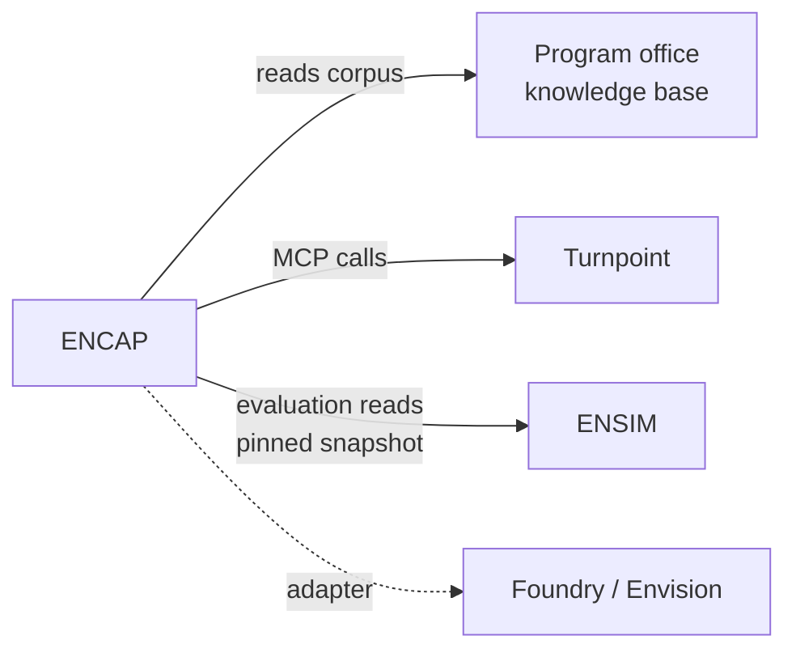

# Acquisition Knowledge System — Reference Architecture

> Source: Claude doc "Acquisition Knowledge System — Reference Architecture", dated 2026-09-29,
> imported 2026-10-17. Two diagrams in the original are not reproduced here; the system-context
> diagram below is redrawn from the text. Where the KB prototype design departs from this
> document, the difference is recorded in `docs/adr/`.

## Purpose and scope

This architecture composes existing projects into one system; it adds no new platform. An Air Force
acquisition organization gets citation-grounded agents over a layered public corpus, with the
Mission Planning program office as the first tenant.

The four projects each keep their repo and their role:

| Project | Role in this system | Boundary |
| --- | --- | --- |
| Program office knowledge base | The corpus: layered public documents from government down to program office | Data only; consumed one-directionally by ENCAP |
| ENCAP | The platform: synthesis to OKF, document graph, index, operating model, agents, personnel console | Owns runtime and governance |
| Turnpoint | A domain tool agents call over MCP; also the pattern for agents-first tool design | Called, never embedded |
| ENSIM | The test enterprise: org-doctrine model, doctrine processes, missions, role-emulating T&E agents | Read as a pinned snapshot for evaluation only |

In scope: public, unclassified documents about the U.S. government, DoD, the Air Force, acquisition
law and process, and specific programs. Out of scope for this phase: CUI, internal program
documents, and classified material. The design reserves seams for them (see Governance).

## Principles

Every principle below is already a convention in the project family; this architecture makes each
one a component, not a guideline.

1. **Every claim cites a source.** Per-claim citation is enforced in synthesis output and in agent
   answers. An uncited claim is a defect, not a style issue.
2. **Flag gaps, never invent.** When the corpus has no answer, agents say so and log the gap to a
   backlog. Gaps drive corpus growth.
3. **Hard classification boundary.** Each document, graph, and agent carries a marking. Nothing
   crosses a boundary except through a reviewed promotion step.
4. **License and provenance tracked.** Each source records origin URL, retrieval date,
   public-release basis, and license.
5. **One-directional dependencies.** Corpus → ENCAP → evaluation reads ENSIM. Cross-referenced,
   never merged.
6. **Agents first, humans verify.** As in Turnpoint, every capability is an API or MCP tool before
   it is a screen. Human UIs exist to review and approve.
7. **Platform-agnostic core.** The core is open (Apache 2.0). Foundry/Envision and other enclaves
   attach through adapters, not rewrites.

## System context

ENCAP is the only runtime; the other three repos are a data source, a called tool, and a test range.

Arrows show dependency direction. Nothing flows back into the corpus, Turnpoint, or ENSIM, which
keeps each repo releasable on its own.

## Logical architecture

Five working layers sit on one governance band and swappable platform ports (the fourth port,
tools, is the MCP contract in the Tools band); the OKF bundles are the only component that is never
replaced.

Requests enter at the top and go down to knowledge; documents enter at Ingest and go up. Governance
and the ports touch every layer, which is why they span the full width.

*(Diagram in the source document.)*

## Knowledge scoping

The corpus is split into five echelon layers, each its own OKF bundle; an agent reads its own layer
and every layer above it, never below. A program office agent can cite DoD policy, but a DoD-policy
agent never sees program specifics. That rule carries straight into the CUI phase, where lower
layers become sensitive.

| Layer | Example public sources | Refresh trigger |
| --- | --- | --- |
| L0 U.S. Government | Title 10 and Title 41, NDAA, appropriations acts, OMB circulars, GAO reports | New NDAA or appropriations; GAO releases |
| L1 DoD | DoDI 5000 series (Adaptive Acquisition Framework), DFARS, PPBE guidance, Joint doctrine | Reissuance or change notice |
| L2 Department of the Air Force | DAFIs and AFIs, Air Force doctrine, AFMC and SAF/AQ structure | Publication change on e-Publishing |
| L3 Portfolio | PAE C3BM structure, portfolio-level strategy and budget exhibits | Budget cycle; reorganization |
| L4 Program office | Mission Planning program: budget justification exhibits, contract awards, public releases | New award, exhibit, or release |

Layers link upward with typed relations: edges in OKF frontmatter, for example implements,
governed-by, funded-by, supersedes. When an upper document changes, the graph walks those edges and
queues every dependent synthesis for re-review. This is how the knowledge graph stays current as
new information arrives.

The operating model (who decides what, how processes flow) is an OKF profile inside each layer. Its
entity types should reuse ENSIM's org-doctrine schema: Organization, Role, C2Node, DoctrineProcess,
Decision. One schema then describes both the real enterprise from the corpus and the simulated one
in ENSIM, so evaluation compares like with like.

## Key flows

Three flows carry nearly every use; each ends in a human-checkable artifact with citations.

### Ingest and update

1. A source watcher detects a new or changed public document and records URL, date, release basis,
   and license.
2. The extractor (isolated process) converts PDF or HTML to text with page anchors.
3. The synthesis agent writes or revises OKF Markdown, one claim per citation, and proposes
   relations: edges.
4. Validators check schema, citation coverage, marking, and layer placement. Failures go to a review
   queue.
5. A reviewer approves in the personnel console; the index rebuilds; dependents of changed documents
   are queued for re-review.

### Grounded question and answer

1. A user or agent asks a question through the console or the MCP interface, under a role.
2. The router picks the scoped agent for the lowest layer the role may read.
3. The agent retrieves by full-text, vector, and graph walk, then answers with per-claim citations.
4. A citation checker confirms each cited passage supports its claim. Unsupported claims are cut and
   logged as gaps.

### Agent task with a domain tool

1. A task arrives, for example assessing a mission planning capability need against current policy.
2. The orchestrator splits it: a policy agent grounds the requirement in L1–L4 documents; a domain
   agent calls Turnpoint over MCP to exercise the planning function.
3. Results merge into one product that cites both corpus passages and tool outputs, each labeled by
   origin.
4. A human approves before anything leaves the system.

## Governance, security, and phasing

The same core runs in all three phases; only the adapters, the marking policy, and the lowest
readable layer change.

| Phase | Environment | Data | What changes |
| --- | --- | --- | --- |
| 1 Public | Unclassified cloud or local; optional Foundry developer instance | Public L0–L4 | Baseline core, open repos |
| 2 CUI pilot | Envision (Foundry on IL5) or other IL5 enclave | Public layers plus CUI program layer and project-level scope | Foundry adapter; CUI marking; enclave identity |
| 3 Higher | Classified enclave, not yet designed | Adds classified layers | Separate deployment; public layers mirrored in, never out |

**Adapters, not rewrites.** Four ports isolate the platform: storage (SQLite → Foundry datasets),
model endpoint (commercial API → enclave-hosted model), identity (local roles → enclave identity),
and tools (MCP → Foundry functions or AIP). In Phase 2 the OKF bundle remains the source of truth and
is projected into Foundry objects; Foundry never becomes the only copy.

**Governance in the console.** Role-based access sets which layers each role reads. Every answer,
synthesis, and tool call is logged with its sources and the model used. Risk classification and
reliability criteria come from the AFMC AI governance policy (v2), applied per use case before it is
enabled.

**Promotion across boundaries.** Content moves only upward in sensitivity, through a reviewed step
that records who promoted it and why.

## Evaluation with ENSIM

ENSIM is the test range: a harness reads a pinned-commit snapshot of its `data/` and `schema/` and
scores the system against known answers. Nothing flows back into ENSIM.

| Test | ENSIM input | Pass condition |
| --- | --- | --- |
| Synthesis fidelity | Cited doctrine publications | Every OKF claim traces to the cited page; no uncited claims |
| Operating-model recovery | org-doctrine-model seed dataset | Organizations, roles, and processes extracted from documents match the seed |
| Role-grounded Q&A | Planned role-emulating T&E agents | Answers cite the right layer and respect the role's read scope |
| Mission task with tools | Mission scenarios (e.g. the Hickam–Luzon airdrop) | Turnpoint outputs and corpus citations agree; gaps are flagged, not filled |
| Gap honesty | Questions with no answer in the corpus | Agent declines and logs a gap |

ENSIM's `apps/mission-planner` is not started. Turnpoint can fill that slot for ENSIM's missions
through the same MCP interface this system uses, so one tool serves both the simulated and the real
enterprise.

## Decisions, risks, and next steps

The biggest alignment gap is that ENSIM models the operational Air Force, while this system serves an
acquisition organization. ENSIM's doctrine processes are operational (tasking, the ATO cycle);
milestone decisions, PPBE, and contracting are not modeled, so acquisition answers cannot yet be
scored against ground truth.

### Recommended positions

- Add acquisition to ENSIM as its own mission set: a fictional program office, its PAE chain, and
  DoctrineProcess records for Adaptive Acquisition Framework pathways. Without it, evaluation covers
  only half the domain. *(Now spec `ensim-acquisition-missions`.)*
- One OKF bundle per echelon layer, linked upward. Simpler than one bundle with scope tags, and it
  maps directly onto CUI separation later.
- Label every output as decision support with citations, not a determination. Acquisition decisions
  carry legal authority that an agent does not hold.
- Keep Foundry as a projection of OKF, never the source of truth, so the public phase and the
  enclave stay in sync.

### Open questions

- [ ] Which acquisition questions matter most to the Mission Planning program office? They set the
      first evaluation set.
- [ ] Is the corpus repo's layer structure already fixed, or can it adopt the five layers above?
- [ ] Which model endpoints are authorized in the IL5 enclave?
- [ ] Does Turnpoint's MCP surface need an acquisition-facing function set (capability
      demonstration), or only planning functions?

### Next steps

- [x] ~~Commit this architecture to the ENCAP repo as docs/ARCHITECTURE.md~~ Superseded: it lives
      in this umbrella repo (ADR 0001), cross-referenced from component repos.
- [ ] Define the operating-model OKF profile against ENSIM's schema.
- [ ] Stand up L1 and L4 first, the thinnest slice that shows policy-to-program traceability.
- [ ] Write five gap-honesty and five role-scope test cases before the first agent ships.
