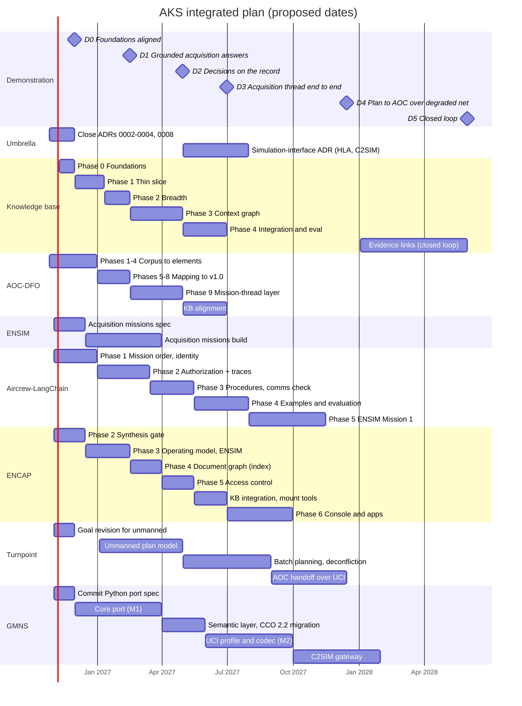
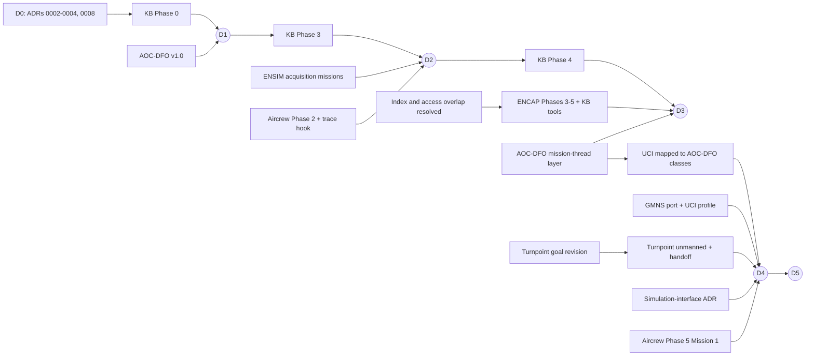

# Integrated milestone plan

- Status: Draft for approval
- As of: 2026-10-25
- Related: [vision](vision.md), [portfolio](../.kiro/steering/portfolio.md), [specs index](specs-index.md)

## Summary

The plan is organized around **six demonstration milestones (D0–D5)**. Each one is a point where AKS
can show new evidence, and each is gated by specific component milestones. The near horizon finishes
at D3 (proposed for June 2027). D4 is the first proof across the mid and far horizons: an unmanned
mission plan reaching the AOC as UCI traffic over a degraded network.

**All dates are proposed, not committed.** They assume one architect at roughly half time directing AI
coding agents across several repos in parallel, the same basis as Turnpoint's estimate. Read
[Capacity](#capacity-and-priority) before relying on dates past D3.

## Demonstration milestones

| ID | Name | Proposed date | What it demonstrates | Gated by |
| --- | --- | --- | --- | --- |
| **D0** | Foundations aligned | 2026-11-30 | Every component follows the shared model and pins; open architecture decisions closed | ADRs 0002–0004 and 0008 decided; KB repo exists; KB/ENCAP overlap resolved (ADR 0009); component repos link the umbrella; Turnpoint goal revised for unmanned planning |
| **D1** | Grounded acquisition answers | 2027-02-15 | **Reliable, secure:** cited answers about the Mission Planning program office; scope limits enforced; gaps declared | KB Phase 2 gate (8 of 10 CQs, precision ≥ 0.90); KB MCP read tools; AOC-DFO v1.0 doctrine layer for alignment |
| **D2** | Decisions on the record | 2027-04-30 | **Safe, traceable:** agents act only within granted authority; every decision is a replayable trace | KB Phase 3 gate (CQ9, CQ10); Aircrew-LangChain Phase 2 (authorization) with the record-then-commit hook; ENSIM acquisition missions producing synthetic decisions |
| **D3** | Acquisition thread end to end | 2027-06-30 | **Near horizon complete:** demonstration thread steps 1–2, graph vs vector evidence, CUI pilot go/no-go | KB Phase 4 (evaluation report, Foundry export); ENCAP Phases 3–5 (operating model, index, access control) and KB integration; AOC-DFO mission-thread layer aligned with the KB ontology |
| **D4** | Plan to AOC over a degraded network | 2027-12-15 | **Mid and far horizon bridge:** thread steps 3–4; Turnpoint plans an unmanned mission and hands it to the AOC as real UCI messages carried by GMNS under latency and outage | Turnpoint unmanned planning and AOC handoff; GMNS Python port M2 with the UCI profile; UCI mapped onto AOC-DFO message classes; Aircrew-LangChain Phase 5 (ENSIM Mission 1); simulation-interface ADR |
| **D5** | Closed loop | 2028, first half | **The single vision:** thread step 5; mission results return to the graph as evidence against the original requirement | Evidence links from runs to requirements in the KB; C2SIM gateway or chosen alternative; scale experiment toward the far-horizon mission volume |

## Timeline

## Where each component stands and what it owes

Status was checked against each repo on 2026-10-25.

| Component | Status now | Next milestone | Owes the integration |
| --- | --- | --- | --- |
| **Knowledge base** | Spec only (umbrella `knowledge-base-prototype`); no repo yet | Repo + Phase 0 (source inventory, confirmed CQs, ontology v0) | D1–D3: the knowledge graph, MCP tools, decision-trace store, evaluation. **On the critical path for D1–D3.** |
| **AOC-DFO** | Requirements v1.1 approved; Phase 0 done (8 of 64 tasks) | Phases 1–4: corpus, doctrine layer, message catalog, elements | D1: doctrine-level classes for KB alignment. D3: mission-thread layer. D4: message classes GMNS maps UCI onto |
| **ENSIM** | Missions 1–3 modeled; org-doctrine schema, HLA federation (Portico), Mission 1 runs end to end; mission planner not started; last commit 2026-09-15 | Design and tasks for `ensim-acquisition-missions` | D2: synthetic acquisition decisions. D4: Mission 1 skeleton for Aircrew-LangChain |
| **Aircrew-LangChain** | Phase 0 done (baseline live2 run); plan v0.1 proposed | Phase 1: mission order and identity | D2: authorization and the decision-node hook. D4: ENSIM Mission 1 flown by agents |
| **ENCAP** | Phases 0–1 done (OKF format, PDF extraction with page anchors); Phase 2 synthesis agent built and its competency-question gate run on real doctrine; Phases 3–6 not started; last commit 2026-09-20 | Close the Phase 2 gate, then Phase 3 (operating model, ENSIM harness) | D3: operating model, index, access control, and the KB tools mounted (ADR 0004). D4: the personnel console as the human-approval surface. **On the critical path for D3 alongside the KB** |
| **Turnpoint** | Phases 1–3 done (route planning, exchange, threat and terrain scorer); class airspace added 2026-10-10 | Goal revision for unmanned aircraft | D4: unmanned planning at volume and the AOC handoff |
| **GMNS** | MATLAB only; last commit 2026-06-24. Python port spec drafted in chat, not committed; ontology files not in the public repo | Commit the port spec and ontology files | D4: UCI traffic under degraded comms. D5: C2SIM gateway |

## Critical dependencies

- **The KB and ENCAP are both critical paths to D3.** The KB is the only near-horizon component
  without a repo; every week its Phase 0 slips moves D1 through D3 by the same week. ENCAP needs four
  more phases before D3 and has been idle since September. Resolving their overlap at D0 shortens
  both.
- **D4 depends on two projects that are not moving.** GMNS has had no commits since June and its
  port spec is not in the repo. Turnpoint's unmanned work needs a goal revision first. Both are
  cheap to start now and expensive to start late.
- **AOC-DFO feeds three milestones.** Its doctrine layer (D1), mission-thread layer (D3) and message
  classes (D4) are each prerequisites somewhere else. Keeping it on schedule protects the most
  downstream work.

## Integration risks

| Risk | Effect | Response |
| --- | --- | --- |
| **Three simulation interfaces.** ENSIM federates over HLA (Portico); GMNS plans a C2SIM gateway; Aircrew-LangChain uses its own scenario format | D4 needs the three simulations to exchange scenarios, orders and reports; three mechanisms mean bespoke bridges | Write the simulation-interface ADR (May–Jul 2027) before D4 work starts. C2SIM and HLA are complementary (C2SIM is often carried over an HLA federation), so the likely answer is a combination, not a choice |
| **ENCAP and the KB build the same things twice.** ENCAP Phase 4 plans a SQLite index and Phase 5 role-based access control; the KB spec plans its own SQLite passage index and scoped tokens | Two indexes and two access models for one corpus; duplicated work on both critical paths to D3 | Decide at D0, as an ADR: one passage index and one access model, owned by ENCAP, with the KB supplying the graph and its MCP tools. This extends ADR 0004 |
| **ENCAP's plan excludes BFO/CCO export** "until a concrete trigger"; its operating model reuses ENSIM's schema | The operating model would sit outside the shared model (ADR 0005) | The KB graph is that trigger. ENCAP's operating-model types map to the shared ontology through the alignment ENSIM already needs (`ontology.md`) |
| ENCAP has had no commits since 2026-09-20 | D3 needs four ENCAP phases in about seven months, in parallel with the KB | Restart ENCAP in November; it is now a second critical path |
| Public data thin at program-office level | D1 under-answers CQ1, CQ5, CQ9 | KB Phase 0 drops or rewords CQs the sources cannot support |
| Synthetic decisions only until CUI | D2 shows the mechanism, not real decisions | Count reviewer decisions as real traces; label synthetic traces everywhere |
| GMNS CCO 1.x to 2.2 migration | Its ontology cannot join the shared model until done | Commit GMNS ontology files with the port spec so the migration can be verified |

## Capacity and priority

Seven components moving in parallel is more than one half-time architect can direct, even with AI
coding agents doing most of the building. If capacity stays as it is, protect the work in this order:

1. **Near horizon to D3:** KB, AOC-DFO, Aircrew-LangChain Phases 1–2, ENSIM acquisition missions,
   ENCAP integration. This is the evidence that the demonstration is about.
2. **Cheap starts for D4:** commit the GMNS port spec and Turnpoint's goal revision now, even if the
   build waits. They unblock later work at almost no cost.
3. **D4 build:** Turnpoint unmanned planning, the GMNS port and UCI, Aircrew-LangChain Phase 5.
4. **D5:** after D4 is shown.

At this capacity, expect D4 to slip into 2028 unless a second person or more agent time is added.

## Open questions

- [ ] **Target date.** Is there a date the demonstration must be ready for? (Audience answered: Air Force
      and contractor personnel.) A fixed date would reorder the priorities above.
- [ ] **Capacity.** Is half time with AI coding agents the right assumption?
