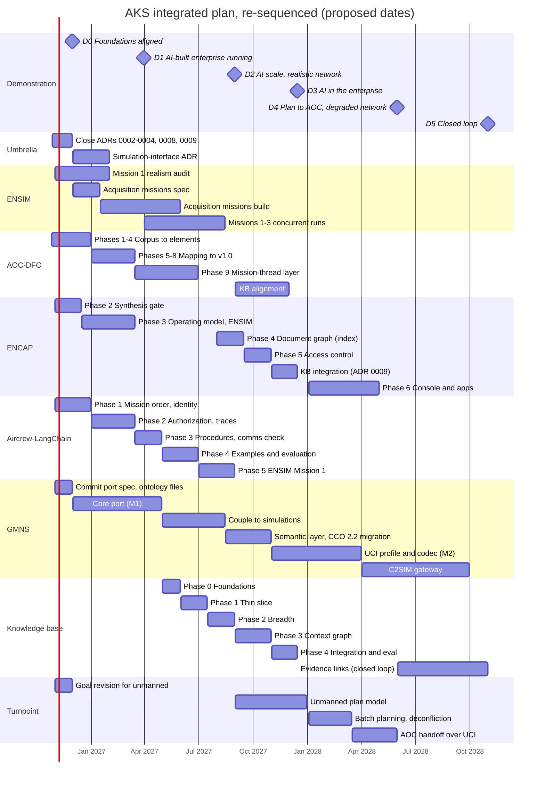
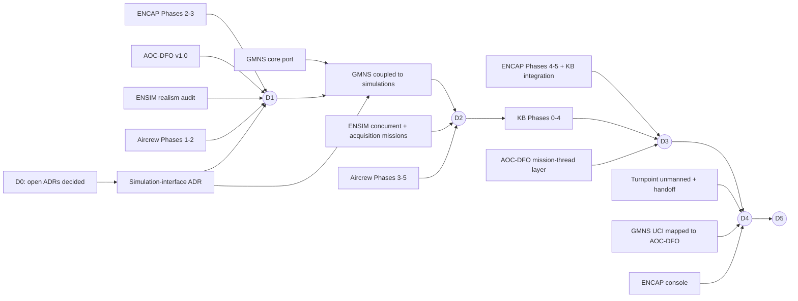

# Integrated milestone plan

- Status: **Baselined 2026-10-26** (commit `38ff131`; to tag it: `git tag plan-baseline-2026-10-26 38ff131`). Progress is tracked against
  this baseline in [progress.md](progress.md); the dates below are not edited as work moves.
- As of: 2026-10-26 (re-sequenced to the two-layer goal)
- Related: [vision](vision.md), [portfolio](../.kiro/steering/portfolio.md), [specs index](specs-index.md)

## Summary

The plan follows the goal's two layers, in order ([vision](vision.md#goal)):

1. **AI architects and simulates the enterprise** (D1, D2): an Air Force enterprise model built from
   public sources with AI, run as a simulation that is realistic and works at scale.
2. **AI is used in that enterprise** (D3, D4): grounded answers, recorded decisions, mission planning
   and operations, shown inside the simulated enterprise.

D5 closes the loop between the two. Each demonstration milestone is a point where AKS can show new
evidence to Air Force and contractor personnel, and each is gated by component milestones.

**All dates are proposed, not committed.** The target date will be revisited once the work is more
integrated. Dates assume the capacity described in [Capacity](#capacity-and-priority); read that
section before relying on anything past D1.

## What changed from the 2026-10-25 plan

| Then | Now | Why |
| --- | --- | --- |
| AI in the enterprise first (KB, ENCAP: D1–D3 by Jun 2027) | Simulation first (D1–D2 by Aug 2027); KB and ENCAP integration at D3 (Dec 2027) | The goal puts the simulated enterprise first and builds on it |
| GMNS port late (D4, Dec 2027) | GMNS port and network coupling early (D2, Aug 2027) | "At scale" and "realistically" both need the network layer |
| Simulation-interface ADR mid-2027 | Simulation-interface ADR by Jan 2027 | D2 couples ENSIM, Aircrew-LangChain and GMNS; the interface must exist first |
| ENCAP Phase 3 late | ENCAP Phases 2–3 early (D1) | ENCAP's synthesis of doctrine into an operating model is AI *architecting* the enterprise |
| Decision traces written to the KB | Decision traces written to files in the trace format until the KB exists, imported later | The KB now starts after D1 |

## Demonstration milestones

| ID | Name | Proposed | What it demonstrates | Gated by |
| --- | --- | --- | --- | --- |
| **D0** | Foundations aligned | 2026-11-30 | Every component follows the shared model and pins; open decisions closed; idle projects restarted | ADRs 0002–0004, 0008, 0009 decided; component repos link the umbrella; GMNS port spec and ontology files committed; Turnpoint goal revised |
| **D1** | The AI-built enterprise, running | 2027-03-31 | **Layer 1, realistic:** an enterprise model synthesized from public doctrine with AI, every element traced to a source or marked representative; agents operating in it under granted authority | ENCAP Phases 2–3 (doctrine synthesis, operating model from ENSIM); AOC-DFO v1.0 (AOC data flows); ENSIM realism audit of Mission 1; Aircrew-LangChain Phases 1–2 (mission order from ENSIM, authorization); simulation-interface ADR |
| **D2** | At scale, over a realistic network | 2027-08-31 | **Layer 1, at scale:** concurrent missions and multiple agent instances per role, communicating over a simulated degraded network, with acquisition processes running in the same enterprise; cost and fidelity measured as scale grows | GMNS Python port (M1) coupled to the simulations; ENSIM Missions 1–3 concurrently and acquisition missions; Aircrew-LangChain Phases 3–5 (context cards, evaluation, ENSIM Mission 1) |
| **D3** | AI in the enterprise: grounded and on the record | 2027-12-15 | **Layer 2, reliable, secure, traceable:** cited answers about the simulated and real enterprise; scope enforced; every agent decision a replayable trace; graph vs vector evidence | KB Phases 0–4; ENCAP Phases 4–5 and KB integration (ADR 0009); decision traces from D1–D2 imported; AOC-DFO mission-thread layer aligned with the KB |
| **D4** | AI in operations: plan to AOC over a degraded network | 2028-05-31 | **Layer 2, safe at the operational level:** Turnpoint plans unmanned missions and hands them to the AOC as UCI messages over GMNS; humans approve through the ENCAP console | Turnpoint unmanned planning and AOC handoff; GMNS UCI profile (M2); UCI mapped to AOC-DFO classes; ENCAP Phase 6 console |
| **D5** | Closed loop | 2028-10-31 | **The single vision:** mission results return to the graph as evidence against the original requirement; scale pushed toward the far-horizon mission volume | KB evidence links; C2SIM gateway or the interface chosen in the ADR |

## Timeline

## Where each component stands and what it owes

Status was checked against each repo on 2026-10-25.

| Component | Status now | Next milestone | Owes the integration |
| --- | --- | --- | --- |
| **ENSIM** | Missions 1–3 modeled; org-doctrine schema; HLA federation (Portico); Mission 1 runs end to end; last commit 2026-09-15 | Mission 1 realism audit; acquisition missions spec | D1: the enterprise model and its realism evidence. D2: concurrent missions and acquisition processes. **On the critical path for D1–D2** |
| **AOC-DFO** | Requirements v1.1 approved; Phase 0 done (8 of 64 tasks) | Phases 1–4 | D1: AOC data flows (v1.0). D3: mission-thread layer aligned with the KB. D4: message classes for UCI |
| **ENCAP** | Phases 0–1 done; Phase 2 synthesis agent built, gate run on real doctrine; last commit 2026-09-20 | Close the Phase 2 gate | D1: doctrine synthesis and the operating model (Phases 2–3). D3: index, access control, KB integration. D4: console |
| **Aircrew-LangChain** | Phase 0 done (baseline run); plan v0.1 proposed | Phase 1: mission order and identity | D1: agents operating under authority. D2: ENSIM Mission 1 with context cards. **On the critical path for D1–D2** |
| **GMNS** | MATLAB only; last commit 2026-06-24; Python port spec drafted in chat, not committed; ontology files not in the public repo | Commit the port spec and ontology files | D2: the network layer the simulations communicate over. D4: UCI. D5: C2SIM. **On the critical path for D2, and the largest schedule risk** |
| **Knowledge base** | Spec only; no repo | Repo and Phase 0 (May 2027) | D3: knowledge graph, graph tools, decision-trace store, evaluation |
| **Turnpoint** | Phases 1–3 done; class airspace added 2026-10-10 | Goal revision for unmanned aircraft | D4: unmanned planning and the AOC handoff |

## Critical dependencies

- **The simulation-interface ADR is now the first gate.** D1 runs ENSIM and Aircrew-LangChain
  together; D2 adds GMNS. ENSIM federates over HLA (Portico), GMNS plans C2SIM, and Aircrew-LangChain
  uses its own format. C2SIM is often carried over HLA, so the answer is likely a combination. It must
  be decided by January 2027.
- **GMNS is the largest schedule risk.** It is idle since June, its port spec is not committed, and D2
  depends on it. The port is also the largest single build in the plan.
- **ENSIM and Aircrew-LangChain carry D1 and D2.** Both are on the critical path for the whole first
  layer.
- **The KB and ENCAP are no longer on the early critical path.** That buys time for ADR 0009 and the
  KB's source inventory, but it moves the first grounded-answer demonstration from February to
  December 2027.

## Integration risks

| Risk | Effect | Response |
| --- | --- | --- |
| **Three simulation interfaces** (HLA in ENSIM, planned C2SIM in GMNS, bespoke in Aircrew-LangChain) | D1 and D2 need them to exchange scenarios, orders, reports and messages | Simulation-interface ADR by January 2027 |
| **"Realistic" is judged by practitioners** | Audience rejects the simulation if it does not match how the enterprise works | Realism audit before D1: every element traced or marked representative; comparison with documented operations; practitioner review of D1 before D2 builds on it |
| **Decision traces before the KB exists** | Spec `decision-traces` R3 assumes `kb_record_decision` is available | Write traces to files in the trace format from D1; the KB imports them at D3. Amend R3 when the spec is next revised |
| **Scale costs money** | Live agent runs cost about $2 each today (Aircrew-LangChain baseline); D2 multiplies agents and missions | Aircrew-LangChain Phase 3 (context cards, sleep) before D2; measure cost per mission at each scale step |
| ENCAP and the KB build the same index and access model | Duplicated work | ADR 0009 at D0 |
| ENCAP's operating model sits outside the shared model | Breaks ADR 0005 | Map operating-model types to the shared ontology during ENCAP Phase 3 |
| GMNS CCO 1.x to 2.2 migration | GMNS ontology cannot join the shared model until done | Commit GMNS ontology files with the port spec |

## Capacity and priority

The dates assume **Kevin at half time, directing AI coding agents that do most of the building**
(confirmed 2026-10-26), with no other contributors. Under that assumption the plan runs four to six streams in
parallel in most months (see the timeline), which is more than one person can direct well.

Working rule at this capacity: **no more than three active streams at a time**, chosen in this
order:

1. **D1:** ENSIM realism audit, ENCAP Phases 2–3, AOC-DFO v1.0, Aircrew-LangChain Phases 1–2, the
   simulation-interface ADR.
2. **Cheap starts now:** commit the GMNS port spec and ontology files; revise Turnpoint's goal.
3. **D2:** the GMNS port and coupling, ENSIM concurrent and acquisition missions, Aircrew-LangChain
   Phases 3–5.
4. **D3 onward.**

The baseline dates were set before the three-stream rule. Expect D2 to forecast later than its
baseline; [progress.md](progress.md) carries the forecast so the baseline stays fixed.

## Backlog (not baselined)

Candidates recorded for later. They carry no dates and do not change the baseline; one is promoted
by adding it to the plan in a new baseline.

| Candidate | Added | Builds on | Earliest sensible start | Note |
| --- | --- | --- | --- | --- |
| **Focused portfolio and resource evaluation** ([vision use case](vision.md#focused-acquisition-portfolio-and-resource-evaluation)) | 2026-10-29 | D2 (missions and network at scale), KB CQ6 (funding), decision traces | After D2; as part of D3 or D5 | First candidate: GEO vs proliferated LEO vs UAS relay for Mission 2 communications. Needs a fictional portfolio in `ensim-acquisition-missions` and a spec of its own when promoted |

## Open questions

- [ ] **Target date.** To be revisited once the work is more integrated (decided 2026-10-26).
- [x] **Capacity.** Half time, directing AI coding agents (confirmed 2026-10-26).
- [ ] **Aircrew-LangChain decision traces.** Confirm traces go to files in the trace format until the
      KB exists.
